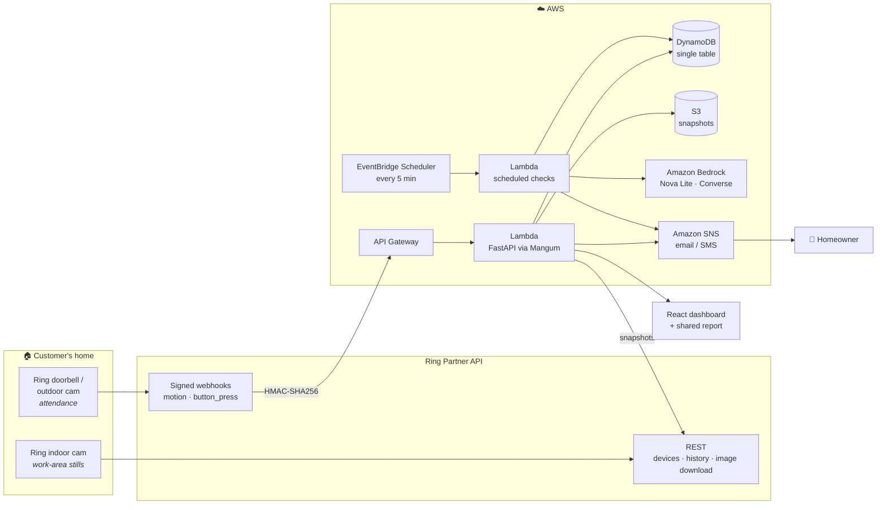
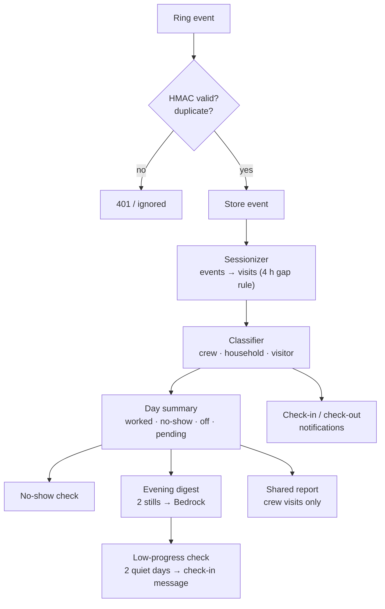

<div align="center">

# 🦺 CrewLog

### Verified service visits for your home, using the Ring camera you already own.

*You're paying a contractor $40,000 for a kitchen. Did anyone show up today?*


Built for the **Ring** track of *Build, Ship, Shape: Amazon Developer Hackathon*, plus the **AWS Builder** mini challenge.

[What it does](#-what-it-does) · [Architecture](#-architecture) · [Tech stack](#-tech-stack) · [Impact](#-real-life-impact) · [Market](#-market-tam--sam--som) · [Why CrewLog](#-unique-value-proposition) · [Run it](#-run-it-locally)

</div>

---

## 🧭 The problem

Homeowners spend tens of thousands of dollars on renovations and recurring home services, but they can't see what they're paying for:

| Question | What homeowners do today |
|---|---|
| **Did the crew come today?** | Call the contractor, or leave work to check |
| **How long did they stay?** | Take the contractor's word for it |
| **Did anything actually get done?** | Wait for a walkthrough, sometimes weeks later |
| **Who's right in a dispute?** | Memory against memory; no shared record |

The camera that could answer all of this is often already on the front door. Nobody has time to scrub through its footage.

## ✨ What it does

CrewLog turns Ring motion events into an honest, automatic work log.

| | Feature | What the homeowner gets |
|---|---|---|
| 🕗 | **Automatic attendance** | Arrival, departure and hours on site, every work day. No timesheets. |
| 🔔 | **Check-in / check-out** | "Crew arrived 8:05 AM" when the van arrives or the crew taps the doorbell; "Crew checked out, 6h 57m" on the way out; an end-of-day summary. |
| 🚫 | **No-show alerts** | If nobody arrives by the expected time plus a grace period, an alert and a polite message to the contractor, ready to send. |
| 🧱 | **Daily progress note** | A morning and an evening still of the work area, compared each evening (Amazon Bedrock vision). |
| 🐢 | **"Presence isn't progress"** | On site, but nothing changed for two work days in a row? A flag and a polite check-in question, never an accusation. |
| 🧑‍🤝‍🧑 | **Crew vs. household vs. neighbour** | Every visit is classified from its *pattern* (doorbell check-in, work van, long stay in work hours). Only crew visits count. **No face recognition.** |
| 🔗 | **Shared weekly report** | One link the contractor sees too: days worked, hours, progress photos. No contact details, no neighbours, no raw camera log. |

<details>
<summary><b>How CrewLog decides who a visit was</b> (no faces, ever)</summary>

| Signal, strongest first | Role |
|---|---|
| Doorbell press during work hours | **Crew**: "Checked in at the doorbell" |
| Vehicle sighting during work hours | **Crew**: "Work vehicle arrived" |
| Stay of 60 min or more during work hours | **Crew**: "Long stay during work hours" |
| Stay of 60 min or more outside work hours | **Household** |
| Anything shorter | **Visitor / neighbour** |
| Package delivery (Ring `sub_type`) | **Delivery**, never work |

Work hours = 2 h before the expected start until 1 h after the end of the work day. Visits never straddle that boundary, so the family coming home in the evening can't stretch the crew's hours.
</details>

---

## 🏗 Architecture



**Inside the backend**



**Design principles**
1. **Runs with zero cloud setup.** Every AWS dependency has a local fallback chosen by environment variables. The same code runs on a laptop or on Lambda.
2. **Real Ring API shapes only.** The backend speaks the Ring Partner API (JSON:API, HMAC-signed webhooks). Pointing `RING_API_BASE` at production is the only switch.
3. **Derived data is recomputed, never patched.** Visits and day summaries are pure functions of stored events, so duplicates and re-runs are harmless.
4. **Privacy by construction.** Motion metadata plus two stills a day. No continuous video, no faces, no describing people.
5. **AI is optional, never a single point of failure.** If Bedrock is unavailable, CrewLog falls back to a fact-based note and keeps working.

## 🧰 Tech stack

| Layer | Technology | Used for |
|---|---|---|
| **Ring** | Ring Partner API, `ring-sandbox` emulator | Webhooks (`motion_detected`, `button_press`), devices, history, image download |
| **Backend** | Python 3.11, FastAPI, Pydantic, httpx | API, webhook verification, sessionizer, classifier, alerts |
| **AI** | Amazon Bedrock (Converse API, Amazon Nova Lite) | Vision progress notes, drafted contractor messages |
| **Data** | Amazon DynamoDB (single table, conditional writes), Amazon S3 | Jobs, events, digests, alerts; snapshots |
| **Alerts** | Amazon SNS | No-show, check-in/out, low-progress, end-of-day summary |
| **Compute** | AWS Lambda + API Gateway (Mangum), Amazon EventBridge Scheduler | API, and checks every 5 minutes |
| **Infra** | AWS SAM (`backend/template.yaml`) | One-command deploy |
| **Frontend** | React 18, Vite, Tailwind CSS | Dashboard, week view, settings, public report |
| **Quality** | pytest (33 tests) | HMAC, dedupe, sessionizer, roles, alerts, privacy of the shared report |

| AWS service | How CrewLog uses it |
|---|---|
| **Amazon Bedrock** | Compares morning and evening stills and writes the progress note as JSON; drafts polite no-show and check-in messages. |
| **Amazon DynamoDB** | Single-table store for jobs, Ring events, digests and alerts. Conditional writes deduplicate Ring webhook retries. |
| **Amazon S3** | Morning and evening snapshots. |
| **Amazon SNS** | Alerts and notifications by email or SMS. |
| **AWS Lambda + API Gateway** | Runs the API and dashboard (FastAPI via Mangum). |
| **Amazon EventBridge Scheduler** | Every 5 minutes: no-show checks, evening digest, end-of-day summary. |

Ring integration in code: [`backend/app/ring/webhook.py`](backend/app/ring/webhook.py) (HMAC-SHA256 over the raw body, payload parsing) and [`backend/app/ring/client.py`](backend/app/ring/client.py) (`GET /v1/devices`, `GET /v1/history/devices/{id}/events`, `POST /v1/devices/{id}/media/image/download`).

> **Note on Bedrock:** the integration is complete and tested, but our new AWS account returns `ValidationException: Operation not allowed` for Nova in every region, even after upgrading to the Paid plan. The demo therefore shows the built-in offline fallback. Details are in the [friction log](docs/friction-log.md).

---

## 🌍 Real-life impact

| Before CrewLog | With CrewLog |
|---|---|
| A no-show is noticed days later, or never | An alert the same morning, with a message ready to send |
| Hours on site are the contractor's word | Hours come from the camera, to the minute |
| Progress is a guess until a walkthrough | A photo-based note every evening |
| Disputes are one person's word against another's | A shared, dated record both sides agreed to see |
| Checking up costs time and trust | It runs on its own; nobody plays detective |

**An illustrative example** (assumed numbers, not data): a six-week, $40,000 kitchen is about $1,300 per scheduled work day. Three silent no-shows are about **$4,000 of schedule** a homeowner pays for without knowing. CrewLog flags each one the same morning.

**Who benefits**
- **Homeowners:** know without calling, and keep a record if anything goes wrong.
- **Honest contractors:** proof of hours and progress, fewer "did you even come today?" calls.
- **Lenders and marketplaces (next):** verified attendance for construction-loan draws and "Verified Pro" badges.
- **Recurring services:** cleaners, lawn crews, pool service and caregivers, where "did they come this week?" matters every week.

---

## 📈 Market: TAM · SAM · SOM

A bottom-up, US-only model. Every assumption is stated so it can be checked or replaced.

| | Definition | Calculation | Size |
|---|---|---|---|
| **TAM** | US homeowners who pay for home projects | ~85 M owner-occupied homes¹ × $60/year² | **≈ $5.1 B / year** |
| **SAM** | …who already have a video doorbell | ~20% of US internet households have one³ → ~17 M × $60 | **≈ $1.0 B / year** |
| **SOM** | Realistic share in 3 years | 1% of SAM → ~170 k homes × $60 | **≈ $10 M ARR** |

**Context: the money CrewLog helps protect**
- US home renovation and repair spending is about **$519 billion a year** ([Harvard JCHS, LIRA](https://www.jchs.harvard.edu/press-releases/remodeling-growth-set-downshift-late-2026)).
- Homeowners averaged **$12,472** on about **10 projects** in 2025 ([Angi State of Home Spending](https://ir.angi.com/node/12961/pdf)).

**Upside not counted above:** construction lenders (paid per verified draw), contractor marketplaces (Verified Pro badges), insurers and warranty providers, and markets outside the US.

<sub>¹ Approximate number of US owner-occupied homes (US Census, rounded); not independently verified here. ² Illustrative price: CrewLog Home at $5/month. ³ [Parks Associates, 2023](https://parksassociates.com/index.php/blogs/pr-smart-home/adoption-of-video-doorbells-reaches-to-20-of-us-internet-households-in-2023): video doorbell adoption reached 20% of US internet households.</sub>

---

## 💎 Unique value proposition

> **A homeowner-side work log built on the camera you already own: automatic, neutral, and private by design.** In our research we found no other tool that does this for homeowners.

1. **No new hardware, no setup for the crew.** It uses the Ring doorbell or cam already on the house.
2. **Neutral record, shared by both sides.** The homeowner and the contractor see the same report.
3. **Presence *and* progress.** Not just "someone was there", but "did anything change?"
4. **Privacy as a feature.** No faces, no continuous video, people are never described, and neighbours never appear on the report.
5. **Polite by default.** Every message to the contractor is a question, not an accusation.

## 🆚 How it's different

| | **CrewLog** | Ring app alone | Jobsite camera services (e.g. OxBlue, TrueLook) | Contractor time-tracking apps | Home-care visit verification (EVV) |
|---|---|---|---|---|---|
| Built for | **Homeowners** | Homeowners | Commercial builders | Contractors | Medicaid home care |
| Hardware | **Camera you already own** | Same | Dedicated jobsite cameras | Worker's phone | Worker's phone |
| Who controls the record | **Neutral, shared** | Homeowner only | Builder | Contractor | Agency |
| Hours on site, automatically | ✅ | ❌ (raw clips) | Partly | ✅ (worker clocks in) | ✅ (worker clocks in) |
| No-show alerts | ✅ | ❌ | ❌ | ❌ | Partly |
| "Did anything change?" | ✅ daily note | ❌ | ✅ time-lapse, AI | ❌ | ❌ |
| Filters out household and neighbours | ✅ | ❌ | n/a | n/a | n/a |
| Worker has to do anything | No (optional doorbell tap) | No | No | Yes | Yes |

Context: commercial jobsite cameras with AI progress tracking already exist ([TrueLook](https://www.truelook.com/lp/oxblue-alternative), [OxBlue](https://www.oxblue.com/en-gb/construction-oversight-with-ai)), and US Medicaid requires electronic visit verification for in-home care ([Medicaid.gov](https://www.medicaid.gov/medicaid/home-community-based-services/guidance/electronic-visit-verification-evv)). People already pay for proof of visit and proof of progress; homeowners just haven't had it.

---

## 🚀 Run it locally

Windows PowerShell, about 5 minutes, no AWS needed. Requires Python 3.11+ and Node 18+.

```powershell
cd D:\hackathon\amazon\backend
python -m venv .venv
.venv\Scripts\Activate.ps1
pip install -r requirements.txt

cd ..\frontend
npm install
npm run build                               # builds the dashboard into backend\static
```

Open **three terminals**, each in `backend` with the venv activated:

```powershell
# 1 · Ring emulator (Ring Partner API shapes, signed webhooks)
ring-sandbox serve --port 8787 --media-dir demo_media

# 2 · CrewLog  (SCHEDULER=false avoids a surprise no-show alert while you demo)
$env:SCHEDULER="false"; uvicorn app.main:app --port 8000

# 3 · Demo driver
python scripts\demo.py all                  # job, doorbell, and a seeded past week
python scripts\demo.py arrive   --at 08:05  # van + crew arrive  → "Crew arrived"
python scripts\demo.py checkin  --at 08:08  # doorbell check-in
python scripts\demo.py out      --at 11:40  # crew steps out to the truck
python scripts\demo.py leave    --at 15:00  # crew leaves
python scripts\demo.py checkout --at 15:03  # doorbell check-out → "Crew checked out"
python scripts\demo.py neighbour --at 19:30 # shown as "also seen", never counted
python scripts\demo.py digest --stall       # no visible progress, 2nd day → check-in alert
python scripts\demo.py summary              # end-of-day summary
```

Open **http://127.0.0.1:8000**. The Today view refreshes every 3 seconds, so injected events appear live. A full recording script is in [docs/video-script.md](docs/video-script.md).

### Configuration

Settings come from environment variables, or from `backend/.env` (git-ignored; real environment variables win). See [`backend/.env.example`](backend/.env.example).

| Env var | Default | |
|---|---|---|
| `RING_API_BASE` | `http://127.0.0.1:8787` | `https://api.amazonvision.com` in production |
| `RING_ACCESS_TOKEN` | `sandbox-token` | OAuth token from Ring account linking |
| `RING_WEBHOOK_SECRET` | `crewlog-dev-secret` | HMAC key shared with Ring |
| `AI_PROVIDER` | `offline` | `offline` or `bedrock` |
| `BEDROCK_MODEL_ID` | `us.amazon.nova-lite-v1:0` | any Converse model with image input |
| `AWS_REGION` | `us-east-1` | |
| `STORE` | `local` | `local` (JSON file) or `dynamo` |
| `SNS_TOPIC_ARN` / `SNAPSHOT_BUCKET` | *(empty)* | enable SNS alerts / S3 snapshots |
| `DEFAULT_TZ` | `Asia/Kolkata` | timezone for new jobs |
| `DEMO_MODE` | `true` | stage photos + `/api/demo/*` |
| `SCHEDULER` | `true` | in-process checks every 60 s (EventBridge does this on AWS) |

### Real AI, DynamoDB and SNS

```powershell
# Bedrock: give the IAM user bedrock:InvokeModel on the Nova Lite inference profile, then
$env:AI_PROVIDER="bedrock"; uvicorn app.main:app --port 8000

# DynamoDB + SNS
python scripts\create_table.py --region us-east-1
$env:STORE="dynamo"; $env:SNS_TOPIC_ARN="arn:aws:sns:us-east-1:<acct>:<topic>"; uvicorn app.main:app --port 8000
```

### Deploy to AWS (SAM)

```powershell
cd backend
sam build
sam deploy --guided   # set RingWebhookSecret, RingAccessToken, AlertEmail
```

The `AppUrl` output is the dashboard. Register `<AppUrl>webhooks/ring` as the webhook URL in the Ring Developer Portal, and confirm the SNS subscription email.

### Tests

```powershell
cd backend
pytest -q   # 33 tests
```

Covers HMAC verification (good, tampered, missing), webhook dedupe, the sessionizer (gap splitting, passers-by, timezone bucketing, status matrix), visit roles (crew, household, neighbour, homeowner corrections), check-in/out and end-of-day notifications, no-show and low-progress alerts, Bedrock reply parsing and fallback, and the privacy of the shared report.

---

## 🔒 Privacy

- Motion event metadata plus **two stills per work day**. Never continuous video.
- **No face recognition.** Roles come from visit patterns, and the AI prompt forbids describing people.
- The shared report hides the contractor's contact details, the raw event log, and all household and neighbour visits.
- The contractor sees the same report as the homeowner: a shared record, not hidden surveillance.

## 🛣 What's next

- **Construction-loan draw verification** for lenders
- **Verified Pro** badges on contractor marketplaces
- **Milestone-based payments** released on verified progress
- Every **recurring home service**: cleaners, landscapers, pool, dog walkers, caregivers
- "That was me" corrections in the UI (already supported by the data model)
- **Alexa+**: "Did the crew show up today?"

## 📚 More

- [TECHNICAL_PLAN.md](TECHNICAL_PLAN.md): modules, contracts, algorithms
- [IMPLEMENTATION_PLAN.md](IMPLEMENTATION_PLAN.md): scope, timeline, demo script
- [docs/friction-log.md](docs/friction-log.md): developer friction with Ring and AWS tooling
- [backend/demo_media/CREDITS.md](backend/demo_media/CREDITS.md): demo photo credits (Unsplash)

## 📄 License

[MIT](LICENSE)
